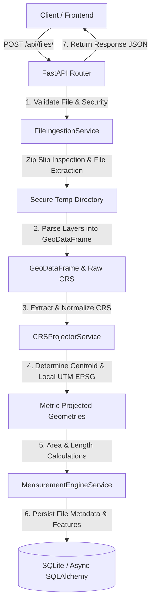

# Geospatial File Measurement API

A production-grade, modular, and fully documented RESTful API built with **FastAPI**, **GeoPandas**, **Shapely**, **PyProj**, **Fiona**, and **Async SQLAlchemy**. 

This service allows users to upload geospatial files (KML documents and Zipped Shapefile archives), inspects archives safely, normalizes Coordinate Reference Systems (CRS), dynamically reprojects features into local metric coordinate reference systems, and calculates precise geometric measurements (area in square meters / hectares, length in meters / kilometers).

---

## Architecture & Data Flow



### CRS Handling & Reprojection Strategy

1. **Source CRS Extraction**:
   - The service inspects incoming KML or Shapefile metadata for CRS definition.
   - If missing or undefined, it defaults safely to `EPSG:4326` (WGS84) and emits a logged warning.

2. **Metric Reprojection Strategy**:
   - Geodetic calculations in angular degrees (lat/lon) lead to severe spatial distortion and incorrect metric values.
   - For every feature, the service calculates its geometric centroid in WGS84 coordinates `(longitude, latitude)`.
   - The service calculates the exact local **WGS 84 / UTM Zone** EPSG code (`EPSG:32601-32660` for Northern Hemisphere, `EPSG:32701-32760` for Southern Hemisphere).
   - If UTM zone resolution fails, it falls back to **World Equal Area** (`ESRI:54009`).
   - All geometries are dynamically reprojected to the target metric projected CRS before calculating area and length.

---

## Tech Stack & Key Libraries

- **Framework**: [FastAPI](https://fastapi.tiangolo.com/) (modern async, Pydantic v2, automatic OpenAPI/Swagger docs).
- **Geospatial Processing Engine**:
  - [GeoPandas](https://geopandas.org/): High-level geospatial data structure manipulation.
  - [Shapely](https://shapely.readthedocs.io/): Vector geometry construction, manipulation, and measurement.
  - [PyProj](https://pyproj4.github.io/pyproj/): Cartographic projection and coordinate transformation engine.
  - [Fiona](https://fiona.readthedocs.io/): OGR/GDAL vector file reader/writer (configured with KML/LIBKML driver support).
- **Persistence**: SQLite with [Async SQLAlchemy 2.0](https://www.sqlalchemy.org/) and `aiosqlite`.
- **Testing**: `pytest`, `pytest-asyncio`, and `httpx`.

---

## Directory Structure

```
geospatial_api/
├── app/
│   ├── api/
│   │   ├── routers/
│   │   │   └── files.py          # FastAPI endpoint handlers
│   │   └── schemas/
│   │       └── files.py          # Pydantic v2 request/response schemas
│   ├── core/
│   │   ├── config.py             # Application settings & environment config
│   │   ├── database.py           # Async SQLAlchemy engine & session setup
│   │   ├── exceptions.py         # Domain-specific custom exceptions
│   │   └── logging.py            # Structured logging configuration
│   ├── models/
│   │   └── file_record.py        # SQLAlchemy ORM models (FileRecord, FeatureMeasurement)
│   ├── services/
│   │   ├── crs_projector.py      # CRS normalization & UTM reprojection engine
│   │   ├── file_ingestion.py     # Safe file upload, zip extraction, & parsing
│   │   └── measurement_engine.py # Area and length measurement engine
│   └── main.py                   # App initialization, CORS, and exception middleware
├── sample_data/                  # Test geospatial files (.kml and .zip Shapefiles)
│   ├── sample_polygon.kml
│   ├── sample_linestring.kml
│   ├── sample_point.kml
│   └── sample_shapefile.zip
├── tests/                        # Comprehensive pytest test suite
│   ├── conftest.py               # Test fixtures and in-memory DB configuration
│   ├── test_api.py               # Integration tests for FastAPI endpoints
│   ├── test_ingestion.py         # Unit tests for file ingestion & zip slip prevention
│   ├── test_measurement.py       # Unit tests for geometry measurement logic
│   └── test_projection.py        # Unit tests for CRS projection & UTM calculation
├── Dockerfile                    # Production Docker container definition with GDAL/GEOS
├── requirements.txt              # Pinned dependencies
└── README.md                     # Complete project documentation
```

---

## Setup & Running Instructions

### Local Execution (Python Virtual Environment)

1. **Clone & Navigate**:
   ```bash
   cd geospatial_api
   ```

2. **Create & Activate Virtual Environment**:
   ```bash
   python -m venv .venv
   # Windows:
   .\.venv\Scripts\activate
   # Linux/macOS:
   source .venv/bin/activate
   ```

3. **Install Dependencies**:
   ```bash
   pip install -r requirements.txt
   ```

4. **Run Server**:
   ```bash
   uvicorn app.main:app --reload --host 0.0.0.0 --port 8000
   ```
   - Swagger Documentation: `http://localhost:8000/api/docs`
   - ReDoc Documentation: `http://localhost:8000/api/redoc`

5. **Run Test Suite**:
   ```bash
   pytest tests/ -v
   ```

---

### Docker Container Execution

1. **Build Container Image**:
   ```bash
   docker build -t geospatial-api:latest .
   ```

2. **Run Container**:
   ```bash
   docker run -d -p 8000:8000 --name geospatial-service geospatial-api:latest
   ```

3. **Verify Health**:
   ```bash
   curl http://localhost:8000/health
   ```

---

## API Endpoints & cURL Examples

### 1. Upload & Process File (`POST /api/files/`)

Uploads a `.kml` or `.zip` file containing Shapefile components (`.shp`, `.shx`, `.dbf`, `.prj`).

**Request**:
```bash
curl -X 'POST' \
  'http://localhost:8000/api/files/' \
  -H 'accept: application/json' \
  -H 'Content-Type: multipart/form-data' \
  -F 'file=@sample_data/sample_polygon.kml;type=application/vnd.google-earth.kml+xml'
```

**Response (`201 Created`)**:
```json
{
  "id": "e4b2a9d8-7c1e-4f3a-9b12-3456789abcde",
  "filename": "sample_polygon.kml",
  "status": "COMPLETED",
  "feature_count": 1,
  "crs": "EPSG:4326"
}
```

---

### 2. Get File Metadata (`GET /api/files/{id}/`)

Retrieves metadata and processing status for an uploaded file.

**Request**:
```bash
curl -X 'GET' \
  'http://localhost:8000/api/files/e4b2a9d8-7c1e-4f3a-9b12-3456789abcde/' \
  -H 'accept: application/json'
```

**Response (`200 OK`)**:
```json
{
  "id": "e4b2a9d8-7c1e-4f3a-9b12-3456789abcde",
  "filename": "sample_polygon.kml",
  "file_size": 564,
  "file_type": "kml",
  "status": "COMPLETED",
  "error_message": null,
  "feature_count": 1,
  "detected_crs": "EPSG:4326",
  "created_at": "2026-10-09T10:30:00Z",
  "updated_at": "2026-10-09T10:30:01Z"
}
```

---

### 3. Get Paginated Feature Measurements (`GET /api/files/{id}/measurements/`)

Retrieves paginated feature measurements extracted from the file.

**Request**:
```bash
curl -X 'GET' \
  'http://localhost:8000/api/files/e4b2a9d8-7c1e-4f3a-9b12-3456789abcde/measurements/?page=1&page_size=10' \
  -H 'accept: application/json'
```

**Response (`200 OK`)**:
```json
{
  "file_id": "e4b2a9d8-7c1e-4f3a-9b12-3456789abcde",
  "total": 1,
  "page": 1,
  "page_size": 10,
  "total_pages": 1,
  "items": [
    {
      "feature_id": "0",
      "geometry_type": "Polygon",
      "properties": {
        "Name": "Test Field Polygon",
        "Description": "A test agricultural parcel"
      },
      "source_crs": "EPSG:4326",
      "projected_crs_used": "EPSG:32618",
      "measurement_status": "COMPLETED",
      "measurements": {
        "area_sq_meters": 7894520.1234,
        "area_hectares": 789.452,
        "length_meters": 11420.5678,
        "length_km": 11.4206
      },
      "error_message": null
    }
  ]
}
```

---

## Design Decisions & Evaluated Alternatives

1. **Dynamic Local UTM Reprojection vs. Fixed Equal-Area Projection**:
   - *Evaluated*: Using a global equal-area projection like `ESRI:54009` (Mollweide) or `EPSG:6933` (World Equal Area) across all inputs.
   - *Decision*: Dynamically determining local WGS 84 UTM zones based on feature centroids yields superior accuracy for local parcel and line measurements while minimizing localized scale distortion.

2. **Zip Slip Security Safeguard**:
   - *Decision*: During Zip extraction, every archive member's canonical destination path is validated against the root temporary extraction directory (`target_path.startswith(target_dir_abs)`), eliminating Zip Slip path traversal vulnerabilities.

3. **Multi-layer KML Aggregation**:
   - *Decision*: Using Fiona's layer discovery (`fiona.listlayers`), multi-layer KML files are automatically discovered, iteratively parsed, and unified into a single processed GeoDataFrame.

4. **Async Persistence with SQLite & SQLAlchemy**:
   - *Decision*: Leveraged `aiosqlite` with `AsyncSession` to maintain a non-blocking request loop during database queries while storing feature records as clean relational models.

---

## Learnings & Future Scope

1. **Asynchronous Background Processing (Celery + Redis)**:
   - For multi-gigabyte shapefile uploads, processing within the HTTP request cycle could lead to connection timeouts.
   - *Future Scope*: Transition file processing to asynchronous task queues using Celery/RabbitMQ or ARQ with Redis, returning `202 Accepted` with background job status polling.

2. **Cloud Object Storage Integration (S3 / GCS)**:
   - Currently, temporary local disk storage (`tempfile`) is used during parsing.
   - *Future Scope*: Store uploaded raw geospatial archives directly in AWS S3 or Google Cloud Storage, passing pre-signed URLs or object keys to background workers.

3. **GeoTIFF & Raster Spatial Measurement**:
   - *Future Scope*: Extend the API engine using `rasterio` to support GeoTIFF elevation/satellite files, computing cell resolutions, surface areas, and slope-adjusted distances.

4. **PostGIS Database Migration**:
   - *Future Scope*: Upgrade database persistence to PostgreSQL with PostGIS spatial extension (`geoalchemy2`), enabling spatial index queries (`ST_DWithin`, `ST_Intersects`) directly at the database tier.
